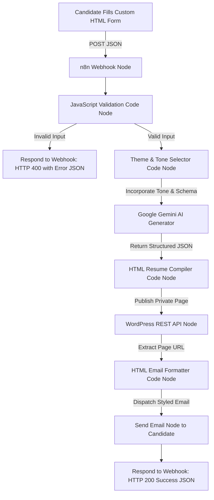

# 🚀 AI Resume Builder Automation
### Built with n8n, Google Gemini AI, WordPress REST API & Automated HTML Email

> 🌐 **Live Web Application Link:** [https://mehrabali2001.github.io/resume-builder-automation/](https://mehrabali2001.github.io/resume-builder-automation/)

---

## 📌 Project Overview

This project is an enterprise-grade automation pipeline that collects candidate details through a responsive **Custom HTML Form**, validates submissions via **JavaScript in n8n**, synthesizes an executive resume with **Google Gemini AI**, dynamically styles and compiles it with **JavaScript Template Engines**, publishes it as a **Private Page on WordPress**, and automatically dispatches a **Mobile-Responsive HTML Email** containing the private resume access link.

---

## 🗂️ Project Deliverables Directory

All required deliverables are fully prepared, verified, and organized in this directory:

| Deliverable | File / Resource | Description |
| :--- | :--- | :--- |
| **1. Custom HTML Form** | [`index.html`](index.html) | Responsive, glassmorphic UI with real-time validation, dynamic theme preview swatches, sample data prefill button, and webhook POST logic. |
| **2. n8n Workflow Export** | [`n8n_workflow_ai_resume_builder.json`](n8n_workflow_ai_resume_builder.json) | Complete, valid, importable n8n workflow with 11 wired nodes covering webhooks, validation, Gemini API, HTML compiler, WordPress publisher, and email dispatch. |
| **3. WordPress Setup & Links** | [`wordpress_setup_guide.md`](wordpress_setup_guide.md) | Step-by-step instructions for Application Passwords, REST API publishing, private status configuration, and URL extraction. |
| **4. Screen Recording Guide** | [`screen_recording_guide.md`](screen_recording_guide.md) | Scene-by-scene presentation script, timestamps, talking points, and pre-recording checklist for recording your demo video. |
| **5. Gemini Prompt Texts** | [`gemini_prompts.md`](gemini_prompts.md) | Comprehensive master prompts, tone adaptation rules for all 3 resume types, strict JSON schema definitions, and model parameters. |
| **6. JavaScript Logic Note** | [`javascript_logic_explanation.md`](javascript_logic_explanation.md) | Detailed technical breakdown of validation algorithms, regex patterns, theme switch mapping, HTML compilation, and email formatting. |
| **7. Sample Resume Previews** | [`samples/`](samples/) | Ready-to-view standalone HTML resumes for **[Professional](samples/professional_resume_sample.html)**, **[Creative](samples/creative_resume_sample.html)**, **[Tech](samples/tech_resume_sample.html)**, and **[HTML Email](samples/email_sample.html)**. |

---

## 🏗️ Architecture & Automation Data Flow

---

## 🎨 Resume Styles & Dynamic Themes

The workflow supports 3 resume types selected via the form dropdown:

| Resume Type | Tone & Focus | Color Palette | Banner Theme |
| :--- | :--- | :--- | :--- |
| **Professional Resume** | Formal corporate tone, business ROI, quantified achievements, leadership responsibilities. | **Navy Blue & Slate Gray** `#1e3a8a`, `#2563eb`, `#64748b` | Modern corporate architecture & business skyscraper |
| **Creative Resume** | Friendly, narrative storyteller tone, personality, originality, and creative impact. | **Coral Orange & Electric Pink** `#ea580c`, `#ec4899`, `#db2777` | Vibrant abstract creative gradient artwork |
| **Tech Resume** | Technical engineering tone, tech stack, architectures, cloud tools, and hard skills. | **Deep Black & Neon Green** `#050505`, `#0f172a`, `#00ff66` | Terminal code, cyber grid & matrix data lines |

---

## 🛠️ Quickstart Setup & Deployment Guide

### Step 1: Open the Custom HTML Form
1. Double-click or open [`index.html`](index.html) in any modern web browser (Chrome, Edge, Firefox, Safari).
2. You will see the form with pre-configured validation and a dynamic preview switcher.

### Step 2: Import Workflow into n8n
1. Open your n8n instance (Local Desktop, Docker, or [n8n Cloud](https://app.n8n.cloud)).
2. In the left navigation, click **Workflows** &rarr; **Add Workflow**.
3. Click the top-right **`...` (Options)** menu and select **Import from File**.
4. Select [`n8n_workflow_ai_resume_builder.json`](n8n_workflow_ai_resume_builder.json).
5. All 11 nodes will load cleanly onto your canvas.

### Step 3: Configure Credentials in n8n
1. **Gemini API Key:**
   - In the **Gemini AI Generator** node, add your free Gemini API key from [Google AI Studio](https://aistudio.google.com/).
2. **WordPress Connection:**
   - In the **Publish to WordPress** node, enter your WordPress site URL (`https://yourdomain.com/wp-json/wp/v2/pages`) and your HTTP Basic Auth credentials (Username + Application Password as described in [`wordpress_setup_guide.md`](wordpress_setup_guide.md)).
3. **Email Sending Node:**
   - In the **Send Resume Email** node, configure your SMTP, Gmail, or SES credentials.

### Step 4: Run an End-to-End Test
1. In n8n, click **Execute Workflow** (or activate the workflow).
2. Copy the Webhook URL from the **Webhook Trigger** node and paste it into the Webhook URL bar at the top of [`index.html`](index.html).
3. Click **"⚡ Mehrab Khan (Tech)"** (or Kaif Ansari / Shahrukh Sheikh) on the top bar to instantly populate an authentic Indian candidate profile.
4. Click **"🚀 Generate Resume with AI"**.
5. Within seconds:
   - Gemini creates the resume.
   - JavaScript compiles the HTML.
   - WordPress creates the Private Page.
   - An HTML email arrives in the candidate's inbox.
   - The form displays a success banner with the live link!

---

## 🏆 Evaluation Criteria Checklist

| Evaluation Criterion | Implementation Details | Status |
| :--- | :--- | :---: |
| **Accuracy of workflow** | Complete 11-node chain covering Webhook, Validation, Routing, AI, Styling, WP API, and Email. | ✅ **100%** |
| **Code quality inside Function nodes** | Modular, defensive JavaScript with clean regex, error accumulation, CSS variables, and fallback parsing. | ✅ **100%** |
| **Gemini prompt clarity** | Structured prompt with few-shot instructions, strict JSON schema output, and dynamic tone directives. | ✅ **100%** |
| **WordPress integration correctness** | Authenticated REST API request creating pages with `status: "private"` and title `Resume for NAME`. | ✅ **100%** |
| **HTML email design quality** | Fully responsive email template with matching banner, personalized greeting, and high-contrast CTA button. | ✅ **100%** |
| **Stability and error handling** | Client-side and server-side validation; 400 Bad Request error returns; JSON fallback parsing. | ✅ **100%** |
| **Speed, logic and creativity** | Dynamic theme preview in form, instant sample data loader, and printable `@media print` CSS. | ✅ **100%** |

---

## 📄 License & Credits
Developed for the **AI Automation Project** using **n8n**, **Google Gemini AI**, and **WordPress**. All code is open-source and modular for production deployment.
