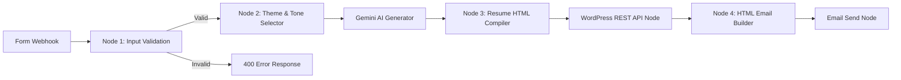

# JavaScript Logic & Architecture Explanation

This document explains the technical architecture, data flow, validation rules, and transformation logic implemented in the JavaScript Function/Code nodes across the **n8n AI Resume Builder Automation**.

---

## 1. Overview of JavaScript Nodes in n8n

The automation workflow relies on **four dedicated JavaScript Code nodes**, each adhering to the Single Responsibility Principle:



---

## 2. Deep Dive: Node by Node

### Node 1: Input Validation & Sanitization (`Validate Input Data`)

#### Purpose
Captures raw incoming data from the webhook payload, applies strict business validation rules, sanitizes inputs, and returns a predictable JSON structure with an `isValid` boolean and an `errors` array.

#### Key Code Snippet
```javascript
const items = $input.all();
const results = [];

for (const item of items) {
  const body = item.json.body || item.json;
  const errors = [];

  // Extract and sanitize strings
  const name = body.name ? String(body.name).trim() : '';
  const email = body.email ? String(body.email).trim() : '';
  const experienceYearsRaw = body.experienceYears !== undefined ? body.experienceYears : body.yearsOfExperience;
  const skills = body.skills ? String(body.skills).trim() : '';
  const workExperience = body.workExperience ? String(body.workExperience).trim() : '';

  // 1. Name validation
  if (!name || name.length === 0) {
    errors.push("Name field must not be empty.");
  }

  // 2. Email format validation
  const emailRegex = /^[a-zA-Z0-9._%+-]+@[a-zA-Z0-9.-]+\.[a-zA-Z]{2,}$/;
  if (!email || !emailRegex.test(email)) {
    errors.push("Email must be in a valid format (e.g. user@domain.com).");
  }

  // 3. Years of experience validation
  const years = Number(experienceYearsRaw);
  if (experienceYearsRaw === undefined || experienceYearsRaw === null || experienceYearsRaw === '' || isNaN(years) || years < 0) {
    errors.push("Years of experience must be a valid non-negative number.");
  }

  // 4. Skills and Work Experience entry validation
  if (!skills || skills.length === 0) {
    errors.push("Skills must have at least one entry.");
  }

  if (!workExperience || workExperience.length === 0) {
    errors.push("Work Experience must have at least one entry.");
  }

  const isValid = errors.length === 0;

  results.push({
    json: {
      isValid,
      errors,
      sanitizedData: isValid ? {
        name,
        email,
        phone: body.phone ? String(body.phone).trim() : '',
        city: body.city ? String(body.city).trim() : '',
        experienceYears: years,
        careerObjective: body.careerObjective ? String(body.careerObjective).trim() : '',
        skills,
        workExperience,
        education: body.education ? String(body.education).trim() : '',
        resumeType: body.resumeType || 'Professional Resume'
      } : null
    }
  });
}

return results;
```

#### Why This Design?
- **Defensive Property Access**: Checks `body.name` after normalizing whether n8n wrapped the webhook payload in `item.json.body` or delivered it directly on `item.json`.
- **Error Aggregation**: Rather than failing on the first invalid field, all validation errors are collected into an array so the user receives a comprehensive list of what needs fixing.
- **Type Coercion & Trimming**: Trims whitespace to prevent false passes on empty spaces (`"   "`). Coerces `experienceYears` safely with `Number()` and verifies `!isNaN()` and `>= 0`.

---

### Node 2: Theme, Tone & Image Selection (`Select Template & Prepare Prompt`)

#### Purpose
Executes switch logic based on the user's dropdown choice (`Professional Resume`, `Creative Resume`, `Tech Resume`) to determine:
1. High-resolution banner image URL.
2. Color palette (Primary, Secondary, Accent, Background, Badge, Card).
3. Font pairings (Google Fonts).
4. Tailored prompt directive injected into Gemini.

#### Key Code Snippet
```javascript
const item = $input.first().json.sanitizedData;
const resumeType = item.resumeType || 'Professional Resume';

let theme = {};
let toneInstruction = '';

if (resumeType === 'Creative Resume') {
  theme = {
    name: 'Creative Resume',
    bannerUrl: 'https://images.unsplash.com/photo-1550684848-fac1c5b4e853?auto=format&fit=crop&w=1200&q=80',
    primaryColor: '#ea580c',   // Orange
    secondaryColor: '#ec4899', // Pink
    accentColor: '#db2777',
    bgColor: '#fff1f2',
    textColor: '#1f2937',
    badgeBg: '#fce7f3',
    badgeText: '#be123c',
    cardBg: '#ffffff',
    fontHeading: "'Playfair Display', Georgia, serif",
    fontBody: "'Outfit', 'Segoe UI', sans-serif"
  };
  toneInstruction = 'Friendly, engaging, narrative tone. Focus on story, personality, imagination, creative thinking, and visual/conceptual impact.';
} else if (resumeType === 'Tech Resume') {
  theme = {
    name: 'Tech Resume',
    bannerUrl: 'https://images.unsplash.com/photo-1526374965328-7f61d4dc18c5?auto=format&fit=crop&w=1200&q=80',
    primaryColor: '#050505',   // Black
    secondaryColor: '#0f172a',
    accentColor: '#00ff66',    // Neon Green
    bgColor: '#080c14',
    textColor: '#e2e8f0',
    badgeBg: 'rgba(0, 255, 102, 0.12)',
    badgeText: '#00ff66',
    cardBg: '#0d131f',
    fontHeading: "'Space Grotesk', -apple-system, sans-serif",
    fontBody: "'Fira Code', 'Courier New', monospace"
  };
  toneInstruction = 'Technical, direct, metrics-driven tone. Highlight programming languages, architectures, tools, cloud infrastructure, libraries, hard skills, and tech performance benchmarks.';
} else {
  // Professional Resume (Default)
  theme = {
    name: 'Professional Resume',
    bannerUrl: 'https://images.unsplash.com/photo-1486406146926-c627a92ad1ab?auto=format&fit=crop&w=1200&q=80',
    primaryColor: '#1e3a8a',   // Navy Blue
    secondaryColor: '#2563eb', // Royal Blue
    accentColor: '#64748b',    // Slate Gray
    bgColor: '#f8fafc',
    textColor: '#0f172a',
    badgeBg: '#eff6ff',
    badgeText: '#1d4ed8',
    cardBg: '#ffffff',
    fontHeading: "'Inter', -apple-system, sans-serif",
    fontBody: "'Inter', -apple-system, sans-serif"
  };
  toneInstruction = 'Formal corporate business tone. Focus on quantified achievements, business ROI, leadership, project management, and core responsibilities.';
}
```

#### Why This Design?
- Centralizes all styling attributes in a single configuration object passed downstream.
- Ensures the Gemini prompt and the subsequent HTML compilation stay completely synchronized with the selected theme.

---

### Node 3: HTML Resume Compiler (`Format Resume to HTML`)

#### Purpose
Consumes the JSON response generated by Gemini and compiles a complete, standalone, production-grade HTML document with embedded CSS variables, typography, bullet points, skills badges, and print stylesheets.

#### Key Architectural Features:
1. **Resilient JSON Parsing**:
   ```javascript
   let rawText = responseItem.candidates[0].content.parts[0].text.trim();
   // Strips possible markdown backticks if returned
   rawText = rawText.replace(/^```json\s*/, '').replace(/\s*```$/, '');
   const resume = JSON.parse(rawText);
   ```
2. **Modular Section Builders**:
   - Loops over categorized skills array to create responsive tag clouds with `<span class="skill-badge">`.
   - Loops over experience items to output timeline cards with company name, title, date badge, and bulleted achievements starting with bold verbs.
   - Generates project cards and achievements blocks.
3. **CSS Variables (`:root`) Theming**:
   - Variables like `--primary`, `--secondary`, `--accent`, `--bg-page` are bound dynamically to the theme chosen in Node 2.
4. **Print Stylesheet (`@media print`)**:
   - Automatically hides UI buttons, expands width, resets background shadows, and formats pages perfectly for saving as PDF via `Ctrl + P`.

---

### Node 4: HTML Email Builder (`Format HTML Email`)

#### Purpose
Generates a mobile-friendly, table-free, lightweight HTML email compatible with Gmail, Apple Mail, and Outlook.

#### Key Elements:
- **Greeting**: Personalized with `Hello ${candidate.name},`.
- **Banner Image**: Displays the matching template banner image directly in the email header.
- **CTA Button**: High-contrast button linking directly to the WordPress Private Page URL (`${wpUrl}`).
- **Privacy Notice & Instructions**: Explains that the page is stored privately and gives quick instructions for exporting as PDF.
- **Contact Footer**: Includes sender attribution and support contact lines.

---

## 3. Error Handling & Stability Considerations

| Scenario | Handled By | Behavior |
| :--- | :--- | :--- |
| **Missing required fields** | Node 1 (Validation) | Returns HTTP 400 Bad Request with a clear list of missing fields; does not call Gemini or consume API quota. |
| **Invalid Email Format** | Node 1 (Validation) | Checks RFC-compliant email regex; rejects invalid addresses before dispatching emails. |
| **Non-Numeric Years** | Node 1 (Validation) | Identifies strings or negative numbers; prompts user for valid numbers. |
| **Malformed Gemini Response** | Node 3 (HTML Compiler) | Wraps `JSON.parse` in `try...catch`; if JSON parsing fails, activates an emergency fallback parser that builds a styled resume using the raw validated form inputs. |
| **WordPress Link Extraction** | Node 4 (Email Builder) | Evaluates `wpData.link` || `wpData.guid?.rendered` with an absolute fallback slug URL. |

---

## 4. Code Quality & Modularity Highlights
- **No Global Scope Pollution**: All variables are scoped locally inside node blocks.
- **DRY (Don't Repeat Yourself)**: Theme parameters are defined once in Node 2 and reused by both HTML Resume and HTML Email builders.
- **Zero Heavy External Dependencies**: Pure native ECMAScript that runs instantly in any n8n environment without requiring external npm packages.
